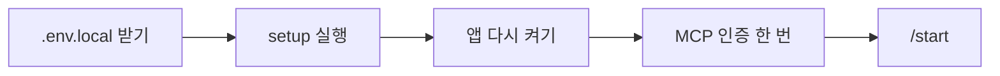
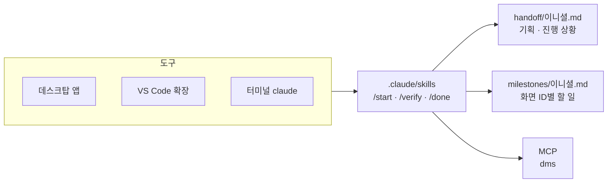
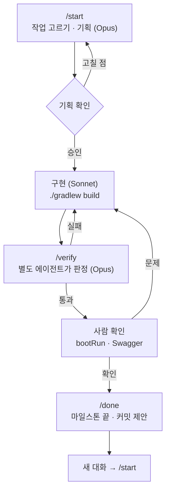
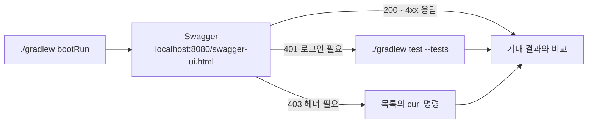

# 냥멍케어 백엔드

반려동물 케어 웹서비스 냥멍케어의 백엔드. Java 25, Spring Boot 4.1, MyBatis, MySQL 8.

- 규칙: `AGENTS.md`, 나머지는 `docs/convention/`
- 아직 정하지 않은 것: `docs/OPEN_ISSUES.md`

## 처음 받았을 때



### setup

| OS | 실행 |
| --- | --- |
| Windows | `setup.bat` (cmd·PowerShell·탐색기 더블클릭) |
| 맥 | `bash setup.sh` |

- 여러 번 실행해도 된다.
- Windows에서 `bash setup.sh`를 치면 WSL이 떠서 안 된다.
- Codex를 쓰려면 Codex를 먼저 설치하고 setup을 실행한다.
- 끝나면 앱(IDE·데스크탑 앱)을 다시 켠다. 새 PATH는 다시 켜야 잡힌다.

| setup이 하는 일 | 내용 |
| --- | --- |
| Git | 사용자 설정, 커밋 훅(`Co-Authored-By` 줄 삭제), 이니셜 브랜치 |
| AI 도구 | Claude Code·Codex 감지. 둘 다 없으면 Claude Code 설치 |
| IDE | VS Code·STS·둘 다 중 선택. 다시 고르려면 `setup.bat --ide` |
| JDK 25 | 없으면 설치 |
| VS Code | 확장(Java Pack, Spring Boot, Claude Code), JDK 등록 |
| STS | 없으면 설치, Lombok, 공용 포맷·UTF-8·LF |
| MCP | `dms`(요구사항정의서·화면설계서·기능명세서) |
| 확인 | 빌드, 공용 DB 접속, 서버 기동 |

직접 할 일:

- `.env.local`을 디스코드에서 받아 `setup.sh` 옆에 둔다.
  - 이름이 `env.local`, `.env.local.txt`로 바뀌지 않았는지 본다.
  - git에 올리지 않는다.
- STS는 처음 한 번 프로젝트를 가져온다.
  - File > Import > Gradle > Existing Gradle Project
  - 상위 폴더가 아니라 `gradlew`가 있는 `backend` 폴더를 고른다.
- DB 접속이 안 되면(학원 밖 등) setup이 할 일로 알려 준다.

### .env.local

Java properties 형식(`키=값`)이다. 같은 이름의 환경변수가 있으면 환경변수가 우선한다.

| 키 | 예 |
| --- | --- |
| `DB_URL` | `jdbc:mysql://호스트:3306/PAWEVER` |
| `DB_USERNAME` | |
| `DB_PASSWORD` | |
| `DMS_MCP_URL` | DMS MCP 서버 주소 |

- 값에 역슬래시(`\`)가 있으면 두 번 쓴다.
- claude.ai 커넥터로 `dms`가 이미 연결돼 있으면 `DMS_MCP_URL`은 비워도 된다.

### MCP

- claude.ai 커넥터로 이미 연결돼 있으면 Claude Code에는 등록하지 않는다.
- 인증: `/mcp` → 서버 선택 → Authenticate
- 데스크탑 앱은 Connectors 화면에서 인증한다(확인 필요).
- Codex는 등록할 때 로그인 창이 뜬다. 놓쳤으면 `codex mcp login dms`.

### 직접 실행

```
./gradlew bootRun
```

- API 명세: `http://localhost:8080/swagger-ui.html`
- `db/`의 SQL은 setup이 실행하지 않는다. 테이블을 바꾼 PR 작성자가 병합 직후 공용 DB에 실행한다(`docs/convention/shared-files.md`).

## AI로 작업하기



| 도구 | 시작 |
| --- | --- |
| 데스크탑 앱 | [다운로드](https://claude.com/download) → Code 탭 → New session → Local, 이 폴더 |
| VS Code 확장 | 이 폴더 열기 → 왼쪽 막대의 Claude 아이콘 |
| 터미널 | 이 폴더에서 `claude` |

- 셋 다 같은 스킬과 MCP를 쓴다.
- STS만 쓰면 VS Code 확장은 직접 설치한다(`anthropic.claude-code`).

### 작업 흐름



| 할 일 | 입력 |
| --- | --- |
| 다음 작업 시작 | `/start` |
| 특정 화면 시작 | `/start COM-003` |
| 기획 승인 | `승인` |
| 검증 | `/verify` |
| 마무리 | `/done` → `확인` → `커밋` |
| 새 대화 | 터미널·VS Code `/clear`, 데스크탑 앱 Ctrl+N |

- 마일스톤 파일이 없으면 첫 `/start`가 먼저 만든다. 시간이 더 걸린다.
- 모델은 바꾸지 않는다. 기본은 Sonnet, `/start`·`/verify`만 Opus로 돈다.
- 스킬이 `/` 목록에 없으면 새 대화를 연다.
- VS Code의 `/clear`는 확인 필요. 안 되면 명령 팔레트의 Open in New Tab.

### 사람 확인

`/verify`가 끝에 주는 "사람 확인" 목록대로 확인한다.



1. `./gradlew bootRun` → `Started … in N seconds`가 나오면 준비 완료
   - 기본 프로필 `local`, `.env.local`의 공용 DB에 붙는다.
2. Swagger에서 목록의 API → Try it out → 값 입력 → Execute
3. 응답 코드와 JSON을 기대 결과와 비교한다.
4. 401이 나면: 로그인 API(AIC)가 아직 없어서다.
   - 목록의 테스트로 확인한다: `./gradlew test --tests '<클래스>'`
   - 결과: `build/reports/tests/test/index.html`
5. 403이 나면: POST·PUT·PATCH·DELETE에 `X-Requested-With` 헤더가 없어서다.
   - 목록의 `curl` 명령으로 부른다.
6. 확인용으로 만든 데이터는 목록의 정리 방법대로 지운다. 공용 DB다.
7. 목록의 "바뀐 파일"을 훑어본다. 기획에 없는 파일이면 문제로 답한다.
8. Ctrl+C로 끈다.

## PR 전 확인

```
./gradlew build
```

테스트는 DB에 붙지 않는다.
